# @mnigos/platform-hono

NestJS HTTP adapter for Hono. Supports Bun and Node.js, and runs `rigtch.fm` in
production.

<!-- benchmark-chart:start -->

<picture>
	<source media="(prefers-color-scheme: dark)" srcset="assets/benchmark-dark.svg">
	
</picture>

<!-- benchmark-chart:end -->

On Bun, platform-hono runs NestJS faster than `@nestjs/platform-fastify` and
`@nestjs/platform-express`. On Node.js it beats platform-express, is about 11%
behind platform-fastify, and is about 18% behind the unreleased
`@nestjs/platform-node` from
[nestjs/nest#18063](https://github.com/nestjs/nest/pull/18063), which runs on
NestJS 12. In the same benchmark, version 0.4.0 serves `GET /` about 4.3x faster
than 0.3.0 on Bun and 2.8x faster on Node.js.

<!-- benchmark-table:start -->

| Runtime | platform-hono | vs platform-fastify | vs platform-express | vs platform-node (unreleased) |
| --- | ---: | ---: | ---: | ---: |
| Bun | 117,870 req/s | +11% | +35% | – |
| Node.js | 90,645 req/s | −11% | +37% | −18% |

Requests per second for `GET /` on Apple M4 with `wrk -t4 -c100` after a 3 s warmup, following the [NestJS benchmark methodology](https://github.com/nestjs/nest/pull/18063). platform-hono, platform-fastify, and platform-express run NestJS 11.2.7. The unreleased platform-node runs NestJS 12.1.2 from [nestjs/nest#18063](https://github.com/nestjs/nest/pull/18063), measured on Node.js only. To measure the adapter on your machine, see [bench/README.md](bench/README.md).

<!-- benchmark-table:end -->

## Installation

```bash
bun add @mnigos/platform-hono hono @hono/node-server @nestjs/common @nestjs/core
```

`@nestjs/common`, `@nestjs/core`, `hono`, and `@hono/node-server` are peer
dependencies. NestJS 11 and 12 are supported. On Node.js, NestJS 12 currently
runs noticeably slower with this adapter than NestJS 11 (about 10-25% fewer
requests per second in local benchmarks) because of higher garbage-collection
work per request; Bun is not affected. This is under investigation. On NestJS 12 the adapter also
supports `@QueryMethod()` routes, `app.useSecurityHeaders()`,
`app.enableCsrfProtection()`, and the `return503OnClosing` option.

This package is ESM-only. CommonJS `require()` is not supported.

## Bootstrap

```ts
import { NestFactory } from '@nestjs/core'
import { HonoAdapter } from '@mnigos/platform-hono'
import { AppModule } from './app.module'

const adapter = new HonoAdapter()
const app = await NestFactory.create(AppModule, adapter)

await app.listen(3000)
```

## Runtime

On Bun, the adapter serves Hono directly with `Bun.serve`. On Node.js it uses
`@hono/node-server`. The default `runtime: 'auto'` picks Bun whenever the `Bun`
global exists, so the same application code runs on both.

```ts
// Bun.serve on Bun, @hono/node-server on Node.js (default)
new HonoAdapter({ runtime: 'auto' })

// Always use @hono/node-server, including on Bun through node:http
new HonoAdapter({ runtime: 'node' })

// Require Bun; Nest bootstrap fails on Node.js
new HonoAdapter({ runtime: 'bun' })
```

`Bun.serve` skips the `node:http` compatibility layer and the
`IncomingMessage` to Fetch `Request` conversion, so it is the faster path on
Bun.

On Node.js, reply bodies are built as `@hono/node-server`'s lightweight
`Response`, which the server writes without reading a Fetch body stream. The
adapter swaps the global `Response` only while Hono builds that response and
restores it right away, so application code keeps the native `Request` and
`Response`.

### Bun server

`app.getHttpServer()` returns a small wrapper around `Bun.serve` instead of a
Node.js `http.Server`. It supports what Nest needs: `listen()`, `address()`,
`close()`, `closeAllConnections()`, `listening`, and the `listening`, `error`,
and `close` events. Code that relies on Node.js server internals, such as
`server.on('connection')`, sockets, `server.timeout`, or WebSocket upgrades
through `node:http`, needs `runtime: 'node'`.

HTTPS works through Nest `httpsOptions`. The Bun path accepts `key`, `cert`,
`ca`, `passphrase`, `requestCert`, `rejectUnauthorized`, and `secureOptions`.
Other options, such as `pfx`, throw during `NestFactory.create`.

Bun closes connections that stay idle, including slow handlers that have not
written a byte yet. The adapter sets Bun's `idleTimeout` to its maximum of 255
seconds and disables it for `@Sse()` streams. Change it with `bun.idleTimeout`
(`0` disables it):

```ts
new HonoAdapter({ bun: { idleTimeout: 60 } })
```

Request size limits are enforced by the adapter on both runtimes. `Bun.serve`
does not expose `GET` and `HEAD` request bodies, so they are never parsed or
limited on Bun. `req.on('close')` fires when the client disconnects; on Bun it
does not fire after a completed response.

Inside Hono handlers on Bun, `c.env` is the `Bun.serve` server, so
`getConnInfo` from `hono/bun` works. Use `getConnInfo` from
`@hono/node-server/conninfo` with `runtime: 'node'`.

## CORS

Use Nest's normal CORS API:

```ts
const adapter = new HonoAdapter()
const app = await NestFactory.create(AppModule, adapter)

app.enableCors({
	origin: 'https://example.com',
})
```

## Body Parsing

Request body parsing is enabled by default unless Nest is bootstrapped with
`bodyParser: false`.

The adapter parses JSON, text, form, and multipart request bodies and stores the
parsed value on `req.body` for Nest controllers and decorators.

```ts
const app = await NestFactory.create(AppModule, new HonoAdapter(), {
	bodyParser: false,
})
```

## Parser Skips

Use `skipBodyParserFor` for routes that need the original request stream, such
as better-auth or webhook endpoints:

```ts
const adapter = new HonoAdapter({
	skipBodyParserFor: ['/api/auth', '/webhooks/stripe'],
})
```

Path matching is segment-aware. A policy for `/api/auth` matches `/api/auth`
and `/api/auth/session`, but not `/api/authentication`.

## Raw Body

When Nest enables `rawBody`, JSON and text bodies are read once. The adapter
stores `req.rawBody` and parses the same payload, avoiding a second stream read.

```ts
const app = await NestFactory.create(AppModule, new HonoAdapter(), {
	rawBody: true,
})
```

## Request Size Limits

The adapter applies a default body limit of 1 MiB to every request body,
including routes where parsing is skipped or disabled.

Configure `bodyLimit` to change the global default, or set `bodyLimit: false`
to disable the global default:

```ts
const adapter = new HonoAdapter({
	bodyLimit: 2 * 1024 * 1024,
})
```

Use route-specific `requestSizeLimits` for upload-heavy paths:

```ts
const adapter = new HonoAdapter({
	requestSizeLimits: [
		{
			path: '/api/uploads',
			maxBytes: 10 * 1024 * 1024,
			errorMessage: 'Upload payload too large',
		},
	],
})
```

If multiple request size limits match, the longest matching path wins.

Malformed JSON and form bodies are rejected as bad requests. Payloads exceeding
the configured limit are rejected as payload-too-large errors.

## Multipart Limits

Use `multipartLimits` to cap `multipart/form-data` bodies part by part:

```ts
const adapter = new HonoAdapter({
	multipartLimits: {
		fileSize: 5 * 1024 * 1024,
		files: 3,
		fields: 20,
		parts: 25,
	},
})
```

- `fileSize`: maximum bytes of a single file
- `files`: maximum number of file parts
- `fields`: maximum number of non-file fields
- `parts`: maximum number of parts, files and fields combined

The limits are checked while the body streams in, so a request is rejected as
soon as it crosses a limit, before the rest of the body is read or parsed.
Status codes match Nest's multer integration: a file over `fileSize` is
rejected as payload-too-large (413, `File too large`), and too many files,
fields, or parts as a bad request (400, `Too many files`, `Too many fields`,
`Too many parts`). The body limits still apply to the whole multipart body.
Part headers must be plain `Name: value` lines separated by CRLF, and a
quoted boundary must not contain a backslash or quote; other forms, which Bun
and Node.js parse differently, are rejected as a bad request.
The parsed `FormData` is checked against the same limits as well. Where Bun's
and Node.js's multipart parsers read a body differently, the streaming check
counts the larger interpretation, and a `Content-Type` with more than one
`boundary=` is rejected as a bad request. Like `bodyLimit`, multipart limits
also apply to routes listed in `skipBodyParserFor`.

## Proxy Trust

Forwarded client IP headers are ignored by default. This prevents direct clients
from spoofing `req.ip` with headers such as `x-forwarded-for`.

Enable `trustProxy` only when the application is deployed behind a trusted proxy:

```ts
const adapter = new HonoAdapter({
	trustProxy: true,
})
```

By default, trusted proxy mode accepts only `x-forwarded-for`. Without trusted
proxy mode, `req.ip` comes from the direct socket connection when available.
The rightmost forwarded address is used, which is safe for a trusted proxy that
appends the connecting client address.

To restrict the accepted headers:

```ts
const adapter = new HonoAdapter({
	trustProxy: {
		headers: ['cf-connecting-ip'],
	},
})
```

For multiple trusted proxies, set `trustedHops` to select the client address
from right to left:

```ts
const adapter = new HonoAdapter({
	trustProxy: { trustedHops: 2 },
})
```

Host headers and redirect targets remain caller-controlled HTTP input. Validate
public origins and redirect destinations in application code before using them
for security-sensitive flows.

## Request Type

The adapter attaches Nest-compatible fields to Hono's request object. Use
`NestHonoRequest` when a controller needs to type `@Req()` access:

```ts
import { Controller, Post, Req } from '@nestjs/common'
import type { NestHonoRequest } from '@mnigos/platform-hono'

@Controller()
export class WebhookController {
	@Post('/webhooks/example')
	handleWebhook(@Req() req: NestHonoRequest) {
		return {
			body: req.body,
			rawBody: req.rawBody,
		}
	}
}
```

Adapter-provided request fields include `body`, `rawBody`, `params`, `query`,
`headers`, `ip`, and `baseUrl`. `req.headers`, and `req.ip` on Bun or with `trustProxy`,
are computed on first read. After a body is parsed, `req.raw` is an unread copy
of the request, created on first access, so consumers such as oRPC can still
read the body.

`req.query` and form bodies are objects without a prototype, so keys such as
`__proto__`, `constructor`, or `toString` are plain values and cannot shadow
`Object.prototype` members.

Nest middleware, guards, and handlers receive a view over Hono's request:
`req.query` there is the parsed object Nest expects, and every other field
and Hono method reads through to `ctx.req`. Hono's own `ctx.req` keeps its
`query()`, `queries()`, `param()`, and `header()` methods, so Hono apps mounted
on the adapter instance, such as `@bull-board/hono`, work alongside Nest:

```ts
const hono = app.getHttpAdapter().getInstance()
hono.route('/admin/queues', serverAdapter.registerPlugin())
```

## Trailing Slashes

The adapter's Hono instance uses Hono's default strict routing, like Nest's
Fastify adapter: `/users/42/` does not match `/users/:id` (Nest's Express
adapter matches both). The same applies to Hono apps mounted with
`hono.route()`: `@bull-board/hono` serves its UI at `/admin/queues`, not
`/admin/queues/`. Redirect the trailing-slash path if clients use it:

```ts
hono.get('/admin/queues/', ctx => ctx.redirect('/admin/queues'))
```

## Response Support

The adapter supports common Nest controller return values:

- JSON-serializable objects and arrays
- strings, numbers, booleans, buffers, and empty responses
- `Promise` and non-SSE `Observable` values resolved by Nest
- `Response` instances from the Fetch API
- `StreamableFile`
- Node.js `Readable` streams
- Web `ReadableStream` streams
- `@Redirect()`, `@Header()`, and `@HttpCode()`
- `@Sse()` handlers returning `Observable<MessageEvent>`

Stream chunks must be strings, `Uint8Array`/`Buffer`, or `ArrayBuffer`.
Object-mode stream chunks are rejected instead of being stringified.

```ts
import { Controller, Get, Sse, StreamableFile } from '@nestjs/common'
import { createReadStream } from 'node:fs'
import { interval, map } from 'rxjs'

@Controller()
export class FilesController {
	@Get('/file')
	file() {
		return new StreamableFile(createReadStream('report.pdf'), {
			type: 'application/pdf',
			disposition: 'attachment; filename="report.pdf"',
		})
	}

	@Get('/raw-stream')
	rawStream() {
		return createReadStream('report.pdf')
	}

	@Sse('/events')
	events() {
		return interval(1000).pipe(map(() => ({ data: { ok: true } })))
	}
}
```

The following Nest response features are intentionally deferred:

- `@Render()` and template/view-engine rendering
- Express/Fastify-style manual response APIs via `@Res()`, such as `res.send()`,
  `res.json()`, `res.end()`, or `stream.pipe(res)`

## Compatibility

| Area | Status |
| --- | --- |
| NestJS controllers and decorators | Supported |
| Hono node server | Supported |
| `Bun.serve` on Bun | Supported |
| JSON, text, form, and multipart bodies | Supported |
| Raw body for JSON and text | Supported |
| Controller `Response`, `StreamableFile`, Node stream, and Web stream returns | Supported |
| Nest `@Sse()` server-sent events | Supported |
| Static assets | Supported |
| CORS | Supported |
| Standard and WebDAV HTTP method decorators | Supported |
| oRPC | Not yet verified |
| better-auth | Planned |
| nestjs-better-auth | Planned |
| Express/Fastify-style manual `@Res()` APIs | Deferred |
| Nest versioning | Unsupported |
| Nest views/templates | Unsupported |
